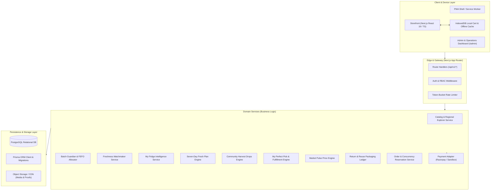
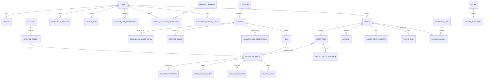

# Phase 0 Architecture & Engineering Specification
## Next-Generation Fruits & Vegetables E-Commerce Platform ("Fresh Harvest")

---

## 1. System Overview & Product Positioning

Fresh Harvest is a commercial, multi-tier e-commerce platform engineered specifically for the perishable produce sector (fruits and vegetables exclusively). Unlike generic grocery stores, the platform models physical produce characteristics—including shelf life, ripening curves, regional varieties, farm origins, physical pick preferences, circular packaging, and household waste reduction.

### 1.1 Core Architectural Principles
1. **Perishable-First Relational Data Modeling**: Produce cannot be tracked as simple numeric SKU balances. Every inventory item is rooted in an **Inventory Batch** linked to a supplier, harvest date, receiving inspection, readiness stage, and storage conditions.
2. **Deterministic Financial & Physical Arithmetic**:
   - Currency: Strict integer arithmetic in **Paise** ($1 \text{ INR} = 100 \text{ paise}$). Zero floating-point drift.
   - Physical Weight: Strict integer units in **Grams** ($1 \text{ kg} = 1000 \text{ g}$).
3. **Transactional Stock Reservation**: Concurrency-safe reservations during checkout prevent overselling and race conditions on scarce batches.
4. **Service & Repository Boundary**: Next.js App Router Route Handlers delegate all domain logic to typed Service layers (`CartService`, `BatchAllocationService`, `QualityEngine`, `CommunityHarvestService`, etc.) backed by Prisma repositories.
5. **Decoupled Architecture with Modular Signature Features**: All 9 signature features (Freshness Matchmaker, My Fridge, Seven-Day Fresh Plan, Community Harvest Drops, Regional Produce Explorer, My Perfect Pick, Market Pulse, Return & Reuse Packaging, Batch Guardian) are autonomous domain modules tied into core commerce without creating hard coupling.

---

## 2. System Architecture Diagram

---

## 3. Database Entity-Relationship (ER) Architecture

The data model uses PostgreSQL via Prisma ORM with strict foreign keys, composite indexes, and enum state machines.

---

## 4. Nine Signature Features Specifications

1. **Freshness Matchmaker**: Query evaluation against `InventoryBatch.readinessStage`, `ripenessWindowStart`, and `ripenessWindowEnd`. Customer picks usage date and purpose $\rightarrow$ system matches batch.
2. **My Fridge Intelligence**: Private household produce inventory. Automatically synced from delivered orders or manual entry; tracks shelf life and prevents duplicate purchasing.
3. **Seven-Day Fresh Plan**: Stock-aware 7-day produce meal planning engine with quantity scaling, recipe ingredient breakdown, and single-click cart export.
4. **Community Harvest Drops**: Collaborative purchasing system for farm-direct perishable harvests with target threshold states, deadline enforcement, and group payment handling.
5. **Regional Produce Explorer**: Dedicated discovery portal for regional Indian cultivars (greens, gourds, mangoes) with verified culinary and seasonal metadata.
6. **My Perfect Pick**: Customer physical produce preferences (firmness, ripeness, size) stored and dispatched directly into warehouse picking queues.
7. **Market Pulse**: Transparent retail vs. historical vs. APMC wholesale benchmark price movements with verified explanations.
8. **Return & Reuse Packaging**: Circular packaging tracking with unique QR codes, deposit ledger, and return pickup scheduling.
9. **Batch Guardian**: Post-delivery customer quality feedback aggregated by inventory batch, with automated threshold alerting and quarantine control.

---

## 5. Security & Threat Mitigation Plan
- Role-Based Access Control (RBAC) across 7 specialized roles.
- Integer Paise currency representation to prevent float rounding bugs.
- Pessimistic locking / Repeatable Read transactions on batch allocations to prevent overselling.
- Idempotency key checking on checkout and payment handlers.
- Cryptographic HMAC verification of payment signatures and webhooks.

